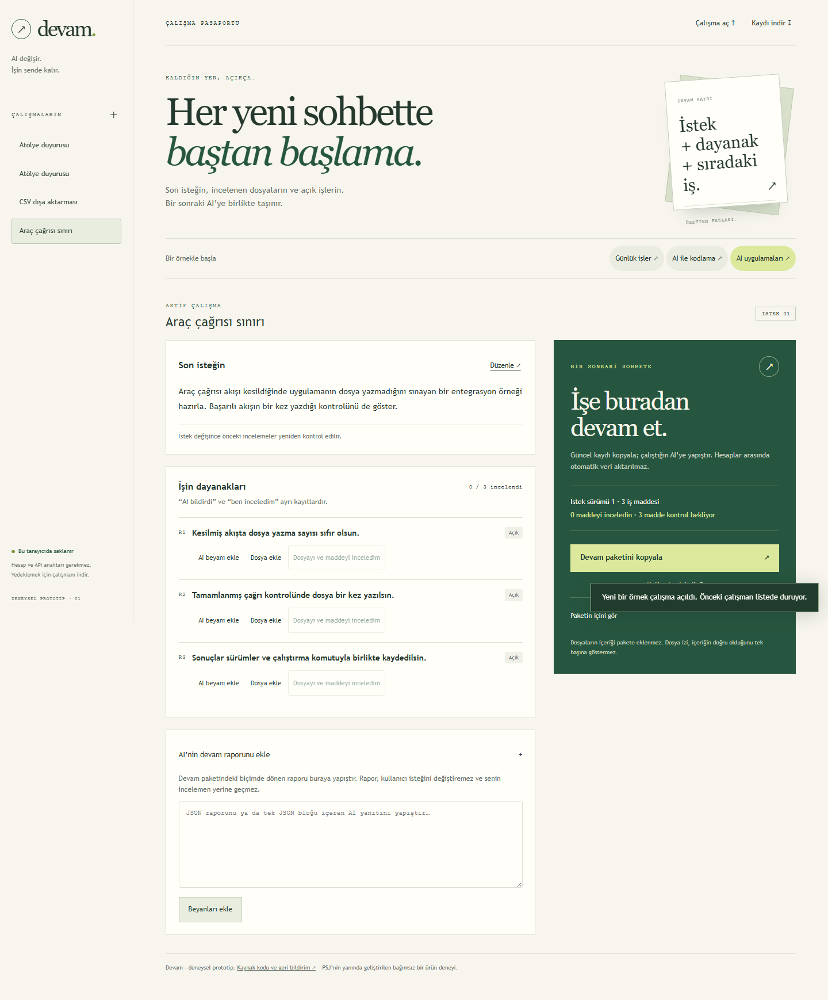

# Devam · çalışma pasaportu

**Deneysel prototip · v0.1.0**

AI sohbetini değiştirirken işini baştan anlatma. Devam; güncel isteğini,
AI'nin tamamladığını söylediği işleri, kendi incelemelerini ve açık kalan
adımları bir sonraki sohbete taşıyabileceğin bir çalışma kaydında toplar.

**[Prototipi aç](https://canblmz1.github.io/devam-prototype/)** ·
[İşleyiş ve sınırlar](docs/WORKFLOW.md) · [Araştırma](docs/RESEARCH.md)



## Bir gerçek işte dene

1. Bir örnek seç veya kendi çalışmanı oluştur. Son isteğini ve iş maddelerini yaz.
2. AI'nin yaptığını söylediği işi **beyan** olarak ekle. Beyan, incelenmiş iş sayılmaz.
3. İlgili dosyayı seç, içeriğini kendin incele ve ilgili maddeye inceleme kaydı ekle.
4. **Devam paketini kopyala** ile metni yeni sohbete taşı. Gerekli dosyaları ayrıca paylaş.
5. AI'den gelen JSON raporunu geri yapıştır. Farklı çalışma veya eski isteğe ait
   raporlar reddedilir. Yeni bir istek ya da farklı dosya, önceki incelemeyi güncel saymaz.

Çalışmayı JSON olarak indirip başka tarayıcıda açabilirsin. Taşınan inceleme
kayıtları yeniden inceleme bekler. Normal sayfa yenileme yerel kaydı korur.

## Yerelde çalıştır

Node.js 22 veya üstü gerekir. Kurulum, hesap, API anahtarı veya model çağrısı gerekmez.

```bash
git clone https://github.com/canblmz1/devam-prototype.git
cd devam-prototype
node server.mjs
```

**http://127.0.0.1:4317** adresini aç. İstersen portu `node server.mjs 4318` ile değiştir.
Dosyaları doğrudan `file://` ile açmak yerine yerel sunucuyu kullan.

## Neler doğrulandı?

- 10 durum testi: istek/çalışma kimliği, beyan ve inceleme ayrımı, eski raporların
  reddi, dosya değişimi, taşınabilir kayıt ve gerçek SHA-256 hesabı.
- 12 tarayıcı akışı: dosya seçimi, pano, indirme/açma, sayfa yenileme, üç kullanım
  örneği ve masaüstü/mobil düzen. Bunlar kullanıcı talebini veya günlük kullanım
  alışkanlığını kanıtlamaz. Henüz bağımsız kullanıcı denemesi raporu yok.

```bash
npm test
python -m pip install -r tests/requirements.txt
python -m playwright install chromium
python tests/run-browser.py
```

Tarayıcı testi kendi yerel sunucusunu başlatır ve kapatır. Sonuçlar ile ekran
görüntüleri `artifacts/devam-ui/` altına yazılır.

## Veri ve prototip sınırları

Çalışmalar tarayıcının yerel depolamasında tutulur; indirerek yedekle.
Uygulama dosya içeriklerini sunucuya göndermez veya kaydetmez: yalnızca ad,
boyut ve SHA-256 izi saklanır. Canlı demo GitHub Pages üzerinden yüklenir;
uygulamada analitik, hesap, model bağlantısı veya bulut eşitlemesi yoktur.

Dosya izi doğruluk kanıtı değildir. İnceleme kaydı kullanıcının yerel beyanıdır;
kimlik doğrulama veya işlem izni sağlamaz. Devam gizli sohbet geçmişini okuyamaz,
silinen sohbetleri geri getiremez veya sonraki AI'nin talimata uyacağını garanti edemez.
Tarayıcıda 12 çalışma, çalışma başına 20 madde, seçilen dosya başına 10 MiB sınırı vardır.

## PSJ ile ilişkisi

Devam, [prefix-safe-json (PSJ)](https://github.com/canblmz1/prefix-safe-json)
içindeki bir deneyden ayrılmış bağımsız prototiptir. PSJ'nin npm paketi veya
desteklenen API'si değildir; şu anda PSJ'yi bağımlılık olarak kullanmaz.
PSJ, akış halinde gelen araç çağrılarının çalıştırılabilmesi için gereken
kanıtları değerlendirir. Devam ise sohbetler arasında çalışma kaydı taşımayı dener.

İlk kaynak: [PSJ deneyinin 4eac2d8 sürümü](https://github.com/canblmz1/prefix-safe-json/tree/4eac2d8d72452849a6c097ea061bb30af4f5e4ad/experiments/devam).
Bu repo Devam için devam eden geliştirme yeridir.

## Geri bildirim

Bir gerçek işi tamamlayıp normal özet/not yöntemine göre neyin kolaylaştığını
ve neyin fazladan uğraş olduğunu [issue açarak](https://github.com/canblmz1/devam-prototype/issues/new/choose)
paylaş. Özel dosya veya sohbet içeriği eklemen gerekmez. İkinci bir gerçek işte
kendiliğinden tekrar kullanmak isteyip istemediğin, yeni özellik listesinden daha
önemli bir ürün sinyalidir.

Lisans: [MIT](LICENSE-MIT) veya [Apache-2.0](LICENSE-APACHE).
